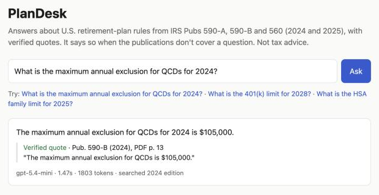

# PlanDesk

<!-- at-a-glance -->
[](https://github.com/pavan139/plandesk/actions/workflows/ci.yml) 

| | |
| --- | --- |
| **Problem** | Retirement-plan limits change every year, and an assistant that answers from memory or from the wrong year's document gives confident wrong numbers. |
| **Result** | 97.1% correct on 35 answerable questions, 7/7 out-of-scope questions refused, every answer backed by a quote that is checked against the source. Closed book: 94.3% with no checkable source, and 3 of 7 out-of-scope questions answered anyway. |
| **Try it** | `uv sync && uv run plandesk ask "What is the SEP IRA limit for 2025?"` (needs `OPENAI_API_KEY`) |
<!-- /at-a-glance -->

Ask a question about U.S. retirement-plan rules. PlanDesk searches IRS Publications 590-A, 590-B and 560 (2024 and 2025 editions), answers with a real LLM, and shows the exact sentence each answer came from. If the publications don't say, it refuses.



## How it works

```text
question ──► year detector ──► hybrid retrieval (BM25 + embeddings, RRF) ──► LLM (JSON: answer + quotes)
                │                       │ filtered to the asked year's edition          │
                ▼                       ▼                                                ▼
      year beyond 2026? refuse    top 6 page-anchored chunks               each quote is checked against its
                                                                            chunk; if none appears verbatim,
                                                                            the answer becomes a refusal
```

| Piece | File | What it does |
| --- | --- | --- |
| Corpus | `src/plandesk/corpus.py` | Extracts 6 PDFs into 1,822 chunks with publication, tax year and PDF page, stripping print-proof lines and re-joining hyphenated words |
| Retrieval | `src/plandesk/retrieve.py` | BM25 and `text-embedding-3-small` fused with reciprocal rank fusion; filters to the edition for the year asked; flags years the corpus can't cover |
| Answering | `src/plandesk/answer.py` | Structured JSON output, verbatim-quote verification, refusal guard |
| Evaluation | `src/plandesk/evaluate.py` | Deterministic scoring, no LLM judge |
| Demo | `src/plandesk/web.py` | One-page FastAPI app showing each quote and whether it verified |

## Results

42 hand-written questions: 35 answerable (contribution limits, a year trap where both editions repeat the same sentence with different numbers, next-year amounts, distribution rules) and 7 the publications can't answer (2028 and 2030 limits, HSA and FSA limits, state tax, fund picks, a company's match formula).

| System | Model | Correct (answerable) | Supported by cited quote | Wrongly refused | Refused when it should (7) | p50 latency | Tokens/query |
| --- | --- | ---: | ---: | ---: | ---: | ---: | ---: |
| Closed book (no retrieval) | gpt-5.4-mini | 94.3% | n/a | 0.0% | 57.1% | 1.34 s | 183 |
| Naive RAG (no year filter, no grounding guard) | gpt-5.4-mini | 97.1% | 94.3% | 2.9% | 100.0% | 1.58 s | 1885 |
| PlanDesk (year-aware hybrid retrieval + verified-quote guard) | gpt-5.4-mini | 97.1% | 94.3% | 2.9% | 100.0% | 1.68 s | 1884 |
| PlanDesk (year-aware hybrid retrieval + verified-quote guard) | gpt-5.4-nano | 88.6% | 85.7% | 11.4% | 100.0% | 1.66 s | 1834 |

Full per-category table and every miss: [`evals/REPORT.md`](evals/REPORT.md).

Check these numbers without an API key: `uv sync && uv run python scripts/report.py` rebuilds `evals/REPORT.md` from the committed runs in `evals/results/`, and `uv run pytest` re-scores them against the release gate.

**What the numbers say, including the unflattering parts**

- **Retrieval is the big win.** But not for raw accuracy. Closed book scored 94.3% because the model already knows most 2024 and 2025 limits. The difference is trust: closed book answered 3 of the 7 questions the publications don't cover (HSA, FSA, California tax) with no source to check, and its 2 misses were confident and wrong, such as telling a 55-year-old that the 2025 IRA limit is $7,000 when Pub. 590-A says $8,000. With retrieval, every answer comes with a quote you can open, and out-of-scope questions are refused.
- **The smaller model refuses too often.** gpt-5.4-nano with the same pipeline got 88.6%: all 4 misses were refusals, two of them from the guard rejecting quotes that weren't verbatim. It never gave a wrong number, which is the failure mode the guard is designed to trade for.
- **The year filter did not change accuracy on this set.** Naive RAG, with both editions in context, scored the same as the full pipeline. The model reads "for 2024" vs "for 2025" correctly once the passage is in front of it. The filter's measurable effect is narrower: naive RAG cited a 2024-edition page for a 2025 question once; the full pipeline never did. A harder test would need questions where the year is implied rather than stated.
- **"Supported" is stricter than "correct".** For the age-50 total deferral question the model correctly added $23,500 + $7,500 = $31,000, but no single cited sentence states $31,000, so it counts as correct but not supported. That is the right call for an audit trail: arithmetic the user can't trace to a sentence should be flagged.
- **One refusal was a model error.** On the first-home question the model had the right quote ($10,000) and still refused.
- **Small set, written by me.** 42 questions is enough to catch regressions, not to claim general accuracy. The questions were written while building the system, so this is not a held-out benchmark.

**Bugs the eval caught during development**

- The model sometimes wrapped citation IDs in brackets (`[560-2025-p10-c2]`). Verification treated them as unknown, the guard turned correct answers into refusals, and the first run scored 82.9%. Normalizing the IDs fixed it, and a test now covers it.
- One expected answer was wrong: I had expected "12 months" for the IRA rollover frequency, but the publication says "1-year period". The label was corrected to accept the source's wording.

## Run it

```bash
uv sync
./scripts/fetch_pdfs.sh            # public-domain IRS PDFs
uv run plandesk build              # PDFs -> data/chunks.jsonl (already committed)
export OPENAI_API_KEY=...
uv run plandesk ask "What was the maximum annual exclusion for QCDs in 2024?"
uv run plandesk serve              # http://localhost:8000
uv run plandesk eval --mode full --model gpt-5.4-mini
uv run python scripts/report.py
```

Embeddings for the corpus are built on first use and cached in `data/embeddings.npy` (about 11 MB, not committed).

## CI as a release gate

`uv run pytest` needs no API key. It tests chunking, matching, retrieval with year filters, quote verification and scoring, then re-scores every committed run in `evals/results/` and fails if the full pipeline drops below 90% accuracy or misses any refusal.

## What I'd change for production

- **Corpus freshness:** watch irs.gov for new editions and rebuild; record the edition date in every citation.
- **Printed page numbers:** citations use PDF page numbers today; map them to printed pages.
- **Arithmetic:** route sums (like base limit + catch-up) through a calculator tool so the derivation is shown and checkable.
- **Harder eval:** implied-year questions, multi-hop rules, and a held-out set written by someone else.
- **Cost tracking:** reports carry raw token counts; add current per-token prices to `PRICES` in `answer.py` for dollar estimates.

## Data and license

IRS publications are U.S. government works in the public domain. Code is MIT. Not tax, legal or investment advice.
